# disk-sim

A hard-disk I/O simulator in C11. It models the mechanics of a drive (zoned
geometry, seek, rotation, transfer), its defect management (P-list slipping,
G-list reallocation), and eight request schedulers up to the
rotational-position ordering that real drives run under NCQ. It replays
synthetic or trace workloads through an event loop and reports throughput, tail
latency, head movement and starvation.

The core is a static library, `libdisksim.a`, behind a single public header
(`include/disksim.h`), so another project can use it as its media layer.

> **This is a simplified model, not real drive firmware.** See [Limitations](#limitations).

## Headline results

All numbers come from `make bench` (5000 requests per run, default 7200 rpm drive).
Full tables are in [`results/results.md`](results/results.md).

| Finding | Measured |
|---|---|
| SPTF vs SSTF, random 4 KiB at 120 IOPS | avg response **58.8 ms vs 96.4 ms (-39%)**, p99 260 vs 383 ms |
| NCQ effect, random 4 KiB, queue depth 32 | SPTF **183.9 IOPS** vs FCFS 77.8 (**2.36x**) and SSTF 145.4 |
| 20,000 grown defects (0.01% of LBAs) | sequential read **77.55 -> 44.94 MB/s (-42.1%)**; random reads: -0.1% |
| SPTF + aging (500 ms) vs pure SPTF | max wait **729 -> 505 ms (-31%)**, same 58.8 ms average |
| SPTF + aging with a 250 ms limit, bursty trace | collapses to FCFS-like behaviour: avg **2,076 ms vs 67.0 ms** |
| Zoned recording | sequential **77.56 MB/s** at the outer edge vs **41.49 MB/s** at the inner edge |
| Cylinder skew | sequential **77.55 MB/s** with skew vs **63.91 MB/s** without (-17.6%) |

## Examples (real screenshots)

Every screenshot below is a real terminal window (WSL Ubuntu) running the
command shown, captured from this repository's build.

**Drive geometry**: 16 recording zones, outer zones hold more sectors per track.

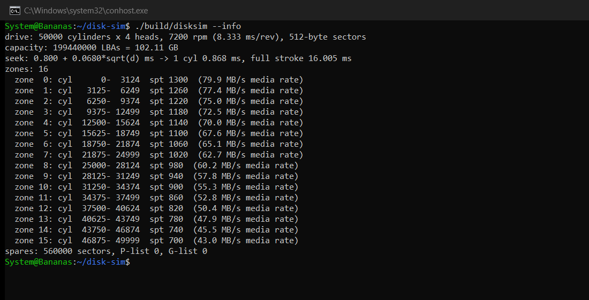

**Unit tests**: 435 checks against hand-calculated expectations.

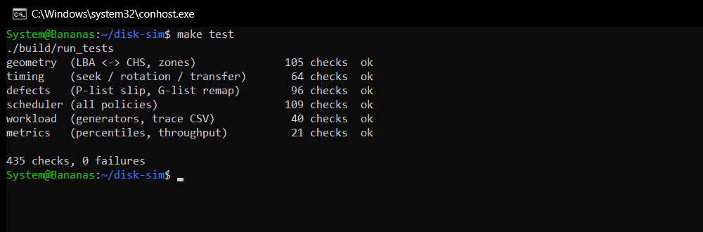

**One simulation**: random 4 KiB reads arriving at 120 IOPS, served by SPTF.

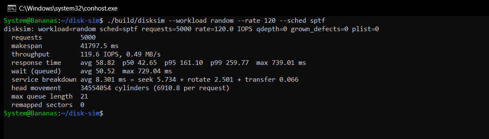

**NCQ in action**: with 32 commands queued, SPTF does 2.36x the IOPS of FCFS by
cutting both seek and rotational latency.

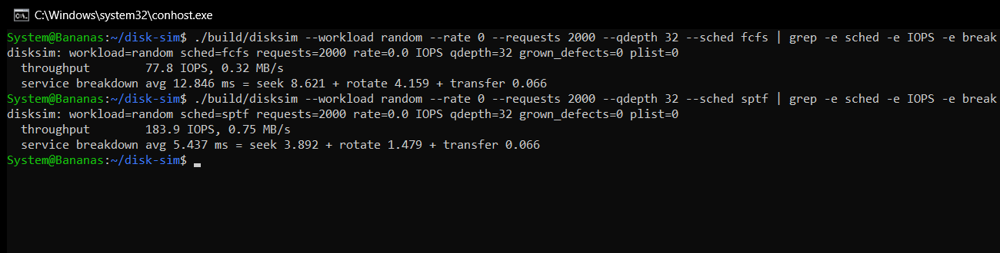

**Grown defects**: 20,000 reallocated sectors drop sequential throughput from
77.55 to 44.94 MB/s; 76 reads had to detour to the spare area.

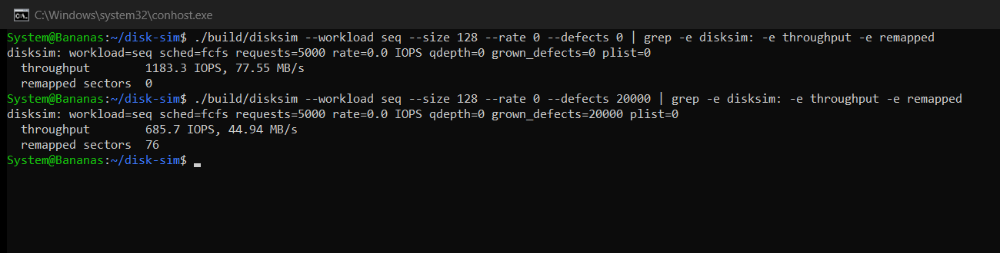

**Trace replay**: the CSV trace format and a run of SPTF with a 500 ms aging limit.

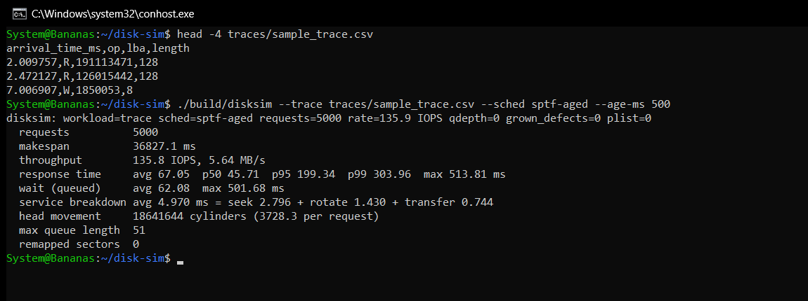

**Sanitizers**: tests and five full simulations under AddressSanitizer + UBSan.

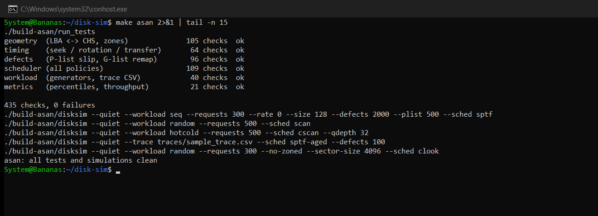

## Architecture

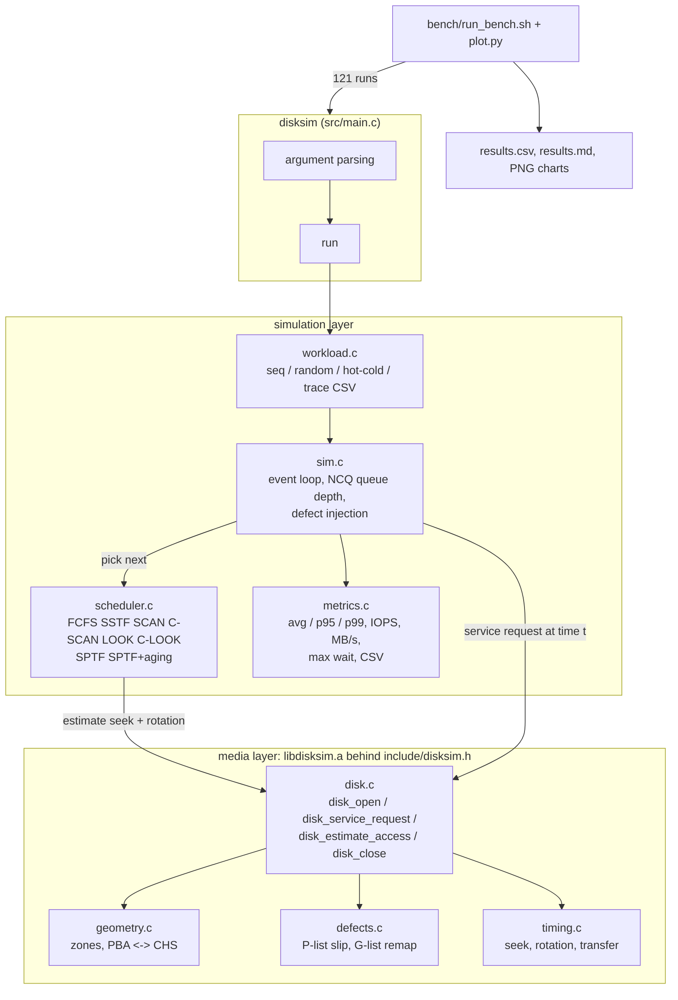

Request path: the workload is generated up front, sorted by arrival time.
`sim_run` admits arrived requests into the drive queue, asks the scheduler which
one to serve, and calls `disk_service_request(disk, req, now)`. The disk
translates LBAs to physical sectors (slipping over factory defects, redirecting
reallocated ones to the spare area), splits the request into per-track extents,
and charges seek + rotational latency + transfer for each one, moving the head.

## Build and run

Requirements: `gcc` (C11), `make`, and Python 3 with matplotlib for the charts.
Linux or WSL (AddressSanitizer is not available with MinGW on Windows).

```bash
make            # build/libdisksim.a, build/disksim, build/gen_trace
```

```bash
make test       # unit tests (435 checks)
```

```bash
make asan       # rebuild with -fsanitize=address,undefined; tests + 5 full simulations
```

```bash
make bench      # 121 runs -> results/results.csv, results/results.md, results/*.png
```

Examples:

```bash
./build/disksim --info
```

```bash
./build/disksim --workload random --rate 120 --sched sptf
```

```bash
./build/disksim --workload seq --size 128 --rate 0 --defects 20000
```

```bash
./build/disksim --trace traces/sample_trace.csv --sched sptf-aged --age-ms 500 --csv out.csv
```

Run `./build/disksim --help` for every option (geometry, zones, seek constants,
queue depth, P-list/G-list injection, CSV and per-request output).

### Using the library from another project

```c
#include "disksim.h"

disk_config_t cfg;
disk_config_default(&cfg);
cfg.rpm = 5400;                         /* override what you need */
int err;
disk_t *d = disk_open(&cfg, &err);

disk_request_t r = { .lba = 123456, .count = 8, .op = DISK_OP_READ };
disk_timing_t t;
disk_service_request(d, &r, now_ms, &t);  /* t.total_ms = seek + rotate + transfer */
disk_close(d);
```

```bash
make lib
```

Link with `-Ipath/to/disk-sim/include path/to/disk-sim/build/libdisksim.a -lm`.
The caller owns the clock: rotational latency depends on the `now_ms` you pass.

## Model

| Component | Model |
|---|---|
| Geometry | cylinders x heads x sectors/track, 512 or 4096 B sectors, zero-based LBA, cylinder 0 = outer edge |
| Zoned bit recording | N equal-width zones, SPT falls linearly from `spt_outer` to `spt_inner` |
| Seek | `0` if distance is 0, else `settle + k * sqrt(distance)` (default 0.8 + 0.068 sqrt(d) ms: 0.87 ms track-to-track, 16.0 ms full stroke) |
| Rotation | platter angle = `(t mod T) / T`; latency = time until the target sector's angle comes under the head |
| Transfer | `sectors / SPT * T`, per track |
| Track crossings | a request is split into per-track extents; head switches are free; cylinder changes pay a seek; cylinder skew (default 0.12 rev) offsets sector 0 per cylinder |
| P-list | factory defects are slipped: LBAs skip them, costing one sector-time each |
| G-list | grown defects are reallocated to spares in the innermost 200 cylinders; a read that hits one seeks there and back |
| Schedulers | FCFS, SSTF, SCAN, C-SCAN, LOOK, C-LOOK, SPTF, SPTF with an age limit |
| Queue | open arrivals (Poisson or trace times), unlimited host queue, optional drive queue depth (NCQ) |

Default drive (`./build/disksim --info`): 7200 rpm (8.333 ms/rev), 50,000
cylinders x 4 heads, 16 zones from 1300 down to 700 sectors/track, 512-byte
sectors, 199,440,000 LBAs = 102.11 GB, 560,000 spare sectors.

## Results

Charts and tables below are from a real `make bench` run. The bench is
deterministic (fixed seeds), so re-running it reproduces these numbers exactly.

### Random 4 KiB reads, Poisson arrivals at 120 IOPS

| scheduler | IOPS | avg ms | p95 ms | p99 ms | max wait ms | head movement (cyl/req) |
|---|---:|---:|---:|---:|---:|---:|
| FCFS | 76.3 | 12,132 | 22,717 | 23,633 | 23,851 | 16,425 |
| SSTF | 119.5 | 96.4 | 265 | 383 | 599 | 3,544 |
| SCAN | 119.5 | 108 | 260 | 354 | 513 | 3,140 |
| C-SCAN | 119.5 | 121 | 251 | 310 | 440 | 3,947 |
| LOOK | 119.5 | 97.0 | 234 | 302 | 454 | 3,358 |
| C-LOOK | 119.5 | 106 | 225 | 281 | 383 | 4,250 |
| SPTF | 119.6 | 58.8 | 161 | 260 | 729 | 6,911 |
| SPTF+aging (500 ms) | 119.6 | 58.8 | 161 | 260 | 505 | 6,929 |

120 IOPS is above what FCFS can sustain (~77 IOPS), so its queue grows for the
whole run. Every other scheduler keeps up, so their IOPS equal the arrival rate
and the difference shows in latency.

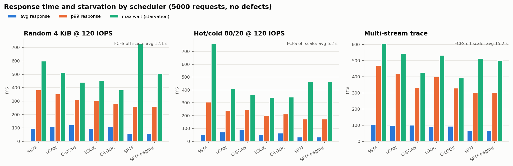

### Where the time goes

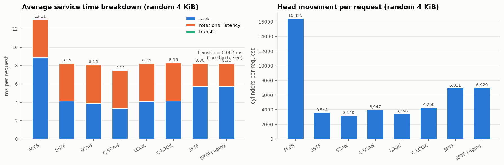

### Queue depth (NCQ)

Random 4 KiB with the host queue always full; the drive sees at most `qdepth` commands.

| queue depth | FCFS | SSTF | LOOK | SPTF |
|---|---:|---:|---:|---:|
| 1 | 77.8 | 77.8 | 77.8 | 77.8 |
| 4 | 77.8 | 100.4 | 98.1 | 108.6 |
| 8 | 77.8 | 114.0 | 114.5 | 130.9 |
| 32 | 77.8 | 145.4 | 145.9 | 183.9 |
| 128 | 77.8 | 169.1 | 169.1 | 267.2 |

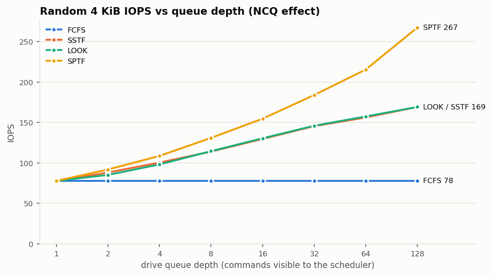

### Grown defects and sequential throughput

| grown defects | MB/s | vs clean | remapped sectors read |
|---:|---:|---:|---:|
| 0 | 77.55 | +0.0% | 0 |
| 2,000 | 74.32 | -4.2% | 5 |
| 5,000 | 66.41 | -14.4% | 18 |
| 20,000 | 44.94 | -42.1% | 76 |
| 100,000 | 19.62 | -74.7% | 310 |

The same 20,000 defects change random 4 KiB throughput by -0.1% (FCFS) and 0.0% (SPTF).

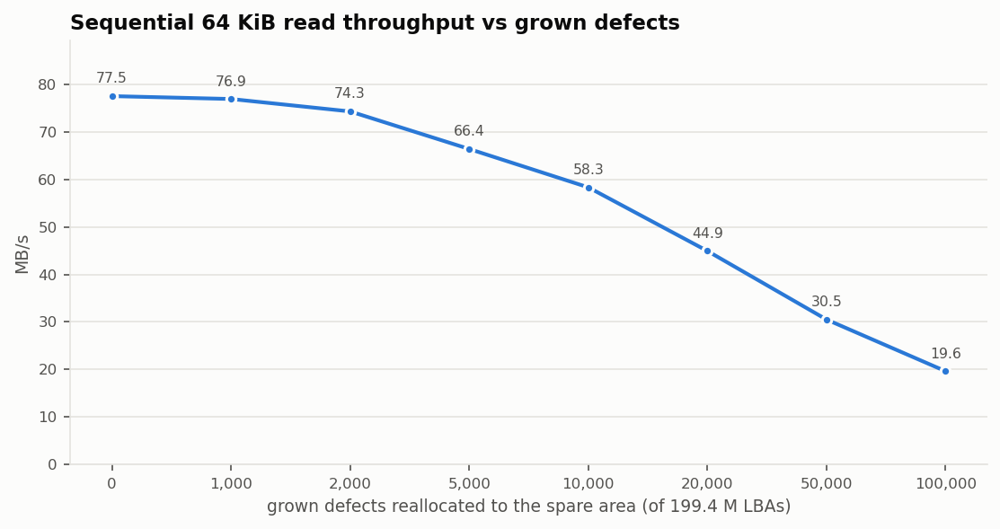

### Zones, skew and aging

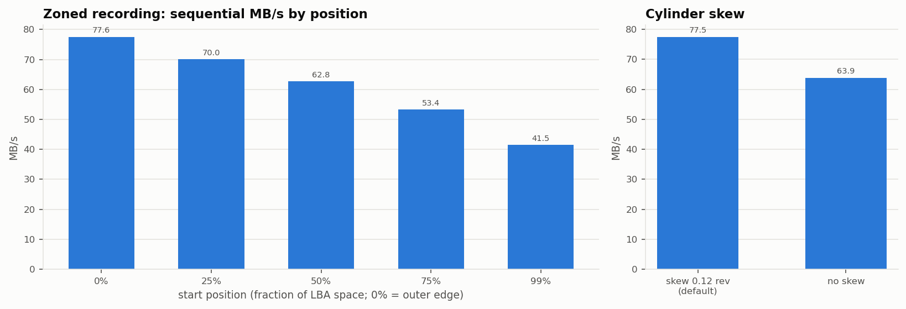

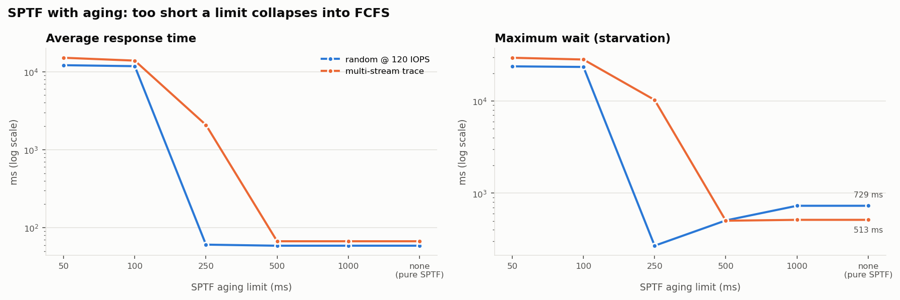

## Key findings

1. **Rotation matters as much as seeking.** On random reads, the seek-only
   schedulers cut the average seek from 8.86 ms (FCFS) to 3.35-4.16 ms, but
   about 4.1-4.2 ms of rotational latency remains in every one of them. SPTF
   accepts a longer seek (5.73 ms) for much less rotation (2.50 ms) and gets the
   lowest response time: 58.8 ms vs 96.4 ms for SSTF. At 120 IOPS the drive is
   ~99.6% busy under every reordering policy and their average service times
   are nearly equal (8.30 ms SPTF, 8.35 ms SSTF); SPTF wins mainly by serving
   the cheapest request first, a shortest-job-first effect that keeps the
   queue shorter (peak 21 vs 28 requests).
2. **Less head movement is not the goal; less time is.** SPTF moves the arm
   6,911 cylinders per request, almost twice SSTF's 3,544, and still answers
   39% faster.
3. **Queue depth is what makes scheduling work.** At depth 1 every policy is
   FCFS (77.8 IOPS). At depth 32, SPTF reaches 183.9 IOPS (2.36x FCFS) and the
   seek-only policies 145-146. Only the drive knows the platter angle, which is
   why NCQ moved this reordering into drive firmware.
4. **Greedy schedulers starve.** On the hot/cold workload SSTF's worst wait is
   760 ms against 342 ms for LOOK. A unit test shows SSTF and LOOK starving a far
   request indefinitely while new work keeps arriving on the head's cylinder.
5. **Aging fixes starvation only if the limit is sane.** With a 500 ms limit,
   SPTF's maximum wait on random reads falls from 729 to 505 ms at no cost in
   average latency. With 250 ms on the bursty trace, the age rule fires so often
   that the scheduler degenerates to FCFS and never recovers: 2,076 ms average
   instead of 67.0 ms.
6. **Grown defects hurt sequential, not random.** 20,000 reallocated sectors
   (0.01% of the disk) cost sequential reads 42.1%, because each one hit means
   a round trip to the inner spare area. Random reads barely notice: they only
   touched 2 remapped sectors.
7. **Where data lives matters.** The outer zone streams at 77.56 MB/s, the
   inner zone at 41.49 MB/s, the same 1300:700 ratio as the sectors per track.
   Without cylinder skew, every cylinder change costs most of a revolution and
   sequential throughput drops 17.6%.
8. **Greedy SPTF is myopic.** On a sequential stream it is 0.4% slower than
   FCFS (77.23 vs 77.55 MB/s): near a cylinder boundary it sometimes grabs a
   request that is a fraction of a millisecond cheaper to reach right now and
   breaks the sequential run.

## Design decisions

| Decision | Why | Alternative considered |
|---|---|---|
| Platter angle computed from simulated time, not stored | Disk state cannot drift from the clock; SPTF estimation is a pure function | Random "half a revolution" latency: simpler, but makes SPTF and back-to-back sequential I/O impossible to model |
| Caller passes `now_ms` into the disk | The library has no clock and fits any event loop | A disk-owned clock: couples the library to one simulator |
| Opaque `disk_t` and int error codes | A linking project only depends on `disksim.h`; internals can change | Exposing structs: faster to write, fragile to link |
| Zone table + binary search | Formula `LBA = (c*H+h)*S+s` breaks once SPT varies; firmware also uses a zone table | Per-track lookup table: more memory, no benefit |
| Sorted arrays for P-list and G-list | P-list is read-only after format; G-list lookups vastly outnumber inserts | Hash map: no "count of defects below X", which slipping needs |
| Requests split into per-track extents | Handles track/cylinder crossings, slipped sectors and remaps with one rule | Treating a request as contiguous: wrong as soon as it crosses a boundary or hits a defect |
| Workloads generated up front | Every scheduler sees identical requests at identical times | Generating on the fly: results would mix scheduler and RNG effects |
| Own PRNG (splitmix64) | `rand()` differs across C libraries; results must be reproducible | `rand()` |
| Nearest-rank percentiles | The reported p99 is a latency some request really saw | Interpolated percentiles |
| Schedulers as "pick one from the queue" functions | Each policy is about 20 lines and unit-testable with a hand-built queue | A priority-queue per policy: faster for huge queues, much harder to read |

## Limitations

This is a teaching model, not firmware. In particular:

- **Seek curve** is `settle + k*sqrt(d)` everywhere; real long seeks become
  coast-limited (closer to linear), and real drives use measured seek tables.
- **Head switches are free**, and there is no track (head) skew, only cylinder skew.
- **Reads and writes cost the same.** Real writes need a tighter settle, and there
  is no write cache, no read-ahead and no on-drive buffer.
- **One spare pool** at the inner edge. Real drives often spread spares per zone
  or per cylinder to shorten the detour; G-list entries are not slipped later by
  a reformat.
- **No errors or retries**: no ECC, no re-reads, no off-track events, no
  thermal recalibration.
- **SCAN-style sweeps are atomic**: requests that arrive while the arm sweeps
  to the edge are not picked up on the way.
- **Single actuator, one command at a time**, no command overlap and no
  power or idle modes.
- **The sample trace is synthetic** (`build/gen_trace`, seed 2024), not a
  captured production trace.
- **Scaled-down geometry**: 50,000 cylinders instead of the ~500,000 tracks
  per surface of a current drive, so absolute MB/s and capacity are smaller
  than a real drive; relative comparisons are what the model is for.

## Future work

- Write cache with write-back and destage scheduling.
- Per-zone spare areas, and a comparison against the single inner pool.
- Seek table from measured data, plus head-switch time with track skew.
- Weighted SPTF aging (cost = positioning time - w * wait) instead of a hard cutoff.
- SMR (shingled) zones with sequential-write constraints.
- Multi-actuator drives.
- Read real block traces (e.g. blktrace / SNIA format) directly.

## Repository layout

```
include/disksim.h     public media-layer API
src/                  library + CLI (main.c)
tests/                unit tests (make test / make asan)
tools/gen_trace.c     synthetic trace generator
traces/               sample trace
bench/                run_bench.sh, plot.py
results/              results.csv, results.md, charts (from make bench)
docs/screenshots/     real terminal screenshots used in this README
LEARNING.md           guided walkthrough of the concepts and the code
INTERVIEW.md          25 interview questions with model answers
```
